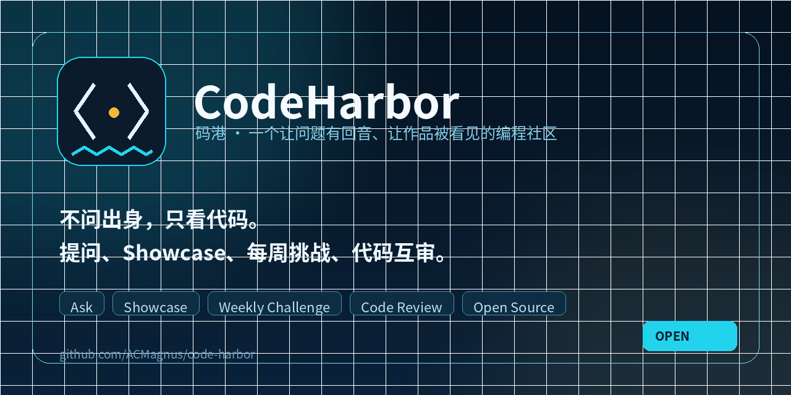

<div align="center">



# CodeHarbor · 码港

**一个让问题有回音、让作品被看见的编程社区。**

不问出身，只看代码。提问、Showcase、每周挑战、代码互审，都在这里发生。

[](https://github.com/ACMagnus/code-harbor/discussions)
[](https://github.com/ACMagnus/code-harbor/blob/main/CONTRIBUTING.md)
[](LICENSE)
[](https://github.com/ACMagnus/code-harbor/discussions)

[**加入讨论**](https://github.com/ACMagnus/code-harbor/discussions) ·
[**第一次提问**](https://github.com/ACMagnus/code-harbor/discussions/categories/q-a) ·
[**展示作品**](https://github.com/ACMagnus/code-harbor/discussions/categories/show-and-tell) ·
[**每周挑战**](https://github.com/ACMagnus/code-harbor/discussions/5) ·
[**资源库**](resources/)

</div>

---

## 这是什么

CodeHarbor 是一个基于 GitHub Discussions 的中文编程社区。没有课程广告，没有焦虑营销，不卖课，也不要求你“先交 999 元”。

这里只做四件事：

- **把问题问清楚**：贴出目标、尝试、报错和环境，让会的人能直接帮你。
- **把作品亮出来**：Demo、截图、Repo、踩坑记录，都值得被看见。
- **把练习坚持下去**：每周一道小挑战，做完就发 Showcase。
- **把代码看仔细**：互相 review，指出具体问题，而不是只说“感觉不对”。

## 你可以在这里做什么

| 板块 | 适合发什么 | 入口 |
| --- | --- | --- |
| 📣 Announcements | 社区公告、规则更新、活动通知 | [进入](https://github.com/ACMagnus/code-harbor/discussions/categories/announcements) |
| 💬 General | 自我介绍、日常交流、学习打卡 | [进入](https://github.com/ACMagnus/code-harbor/discussions/categories/general) |
| 🙏 Q&A | 报错、选型、学习路径、代码问题 | [进入](https://github.com/ACMagnus/code-harbor/discussions/categories/q-a) |
| 🙌 Show and tell | 项目、Demo、截图、踩坑复盘 | [进入](https://github.com/ACMagnus/code-harbor/discussions/categories/show-and-tell) |
| 💡 Ideas | 社区功能、活动形式、板块建议 | [进入](https://github.com/ACMagnus/code-harbor/discussions/categories/ideas) |
| 🗳️ Polls | 投票、选题、技术栈小调查 | [进入](https://github.com/ACMagnus/code-harbor/discussions/categories/polls) |

## 新人三步

1. **读规则**：先看 [START-HERE.md](START-HERE.md) 和 [CODE_OF_CONDUCT.md](CODE_OF_CONDUCT.md)。
2. **打个招呼**：到 [自我介绍帖](https://github.com/ACMagnus/code-harbor/discussions/3) 说一句你在学什么、想做什么。
3. **发第一个问题或作品**：不用等“学完再发”，现在就可以。

## 本周挑战

**#001 · 命令行待办清单**

用任意语言写一个 CLI Todo：能添加、完成、删除、列出任务，数据保存到本地文件。做完把代码或截图发到 Show and Tell。

- [查看题目](challenges/001-cli-todo.md)
- [提交作品](https://github.com/ACMagnus/code-harbor/discussions/categories/show-and-tell)
- [往期挑战](challenges/)

## 提问模板

```text
目标：我想实现什么
已尝试：我试过什么，结果如何
报错 / 代码：完整报错或最小可复现代码
环境：系统 / 语言版本 / 工具版本
```

把问题问清楚，比“有人吗”更容易得到答案。

## 社区规则

- 不人身攻击、不歧视、不嘲讽新手。
- 不灌水、不刷屏、不发与编程无关的广告。
- 不发布 API Key、密码、Cookie、身份证等敏感信息。
- 不传播盗版课程、破解软件和来源不明的二进制。
- 转载注明出处；引用代码注明许可。
- 违规内容会被删除，反复违规会被移出社区。

完整版：[CODE_OF_CONDUCT.md](CODE_OF_CONDUCT.md)

## 参与贡献

- 想改网站、模板、文档：看 [CONTRIBUTING.md](CONTRIBUTING.md)。
- 想报 Bug 或提功能：用 [Issues](https://github.com/ACMagnus/code-harbor/issues/new/choose)。
- 想聊方向、找搭子、发起活动：去 [Discussions](https://github.com/ACMagnus/code-harbor/discussions)。
- 安全问题：不要公开贴利用细节，按 [SECURITY.md](SECURITY.md) 私密报告。

## 目录

```text
index.html            社区主页（GitHub Pages）
challenges/           每周挑战题目与提交说明
resources/            编程学习资源库
showcase/             作品展示模板
CONTRIBUTING.md       贡献指南
CODE_OF_CONDUCT.md    社区行为准则
GOVERNANCE.md         治理与维护者角色
ROADMAP.md            社区路线图
START-HERE.md         新人入口
```

## 维护者

由 [@ACMagnus](https://github.com/ACMagnus) 发起和维护。社区规则、版块和活动都欢迎一起改。

## License

[MIT](LICENSE) © 2026 竹下一刀魂

---

如果这个社区对你的下一次提问、下一个项目有一点点帮助，点一个 **Star**，或者把链接发给一个正在学编程的朋友。
